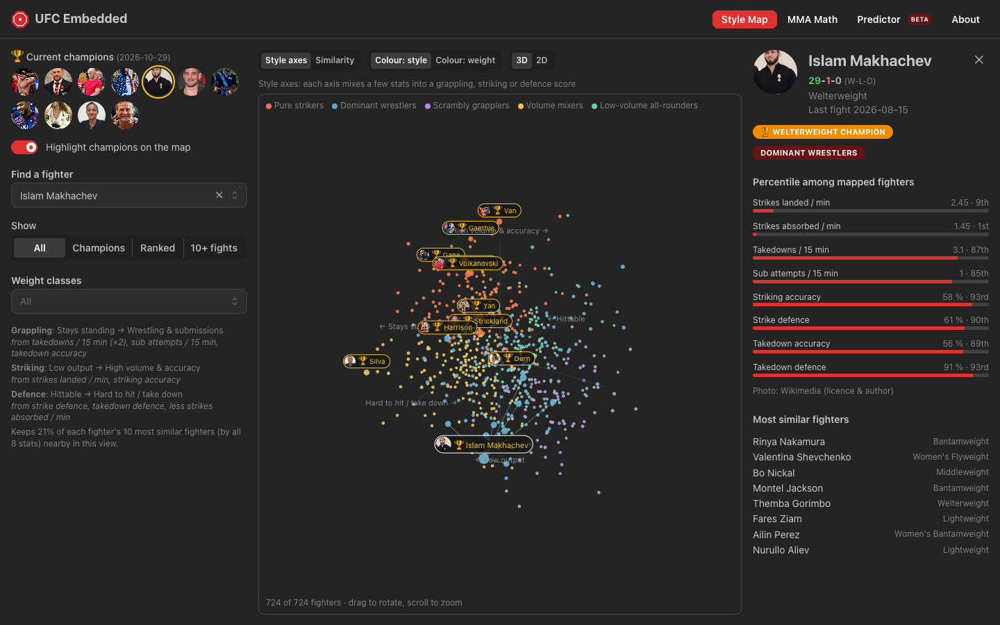
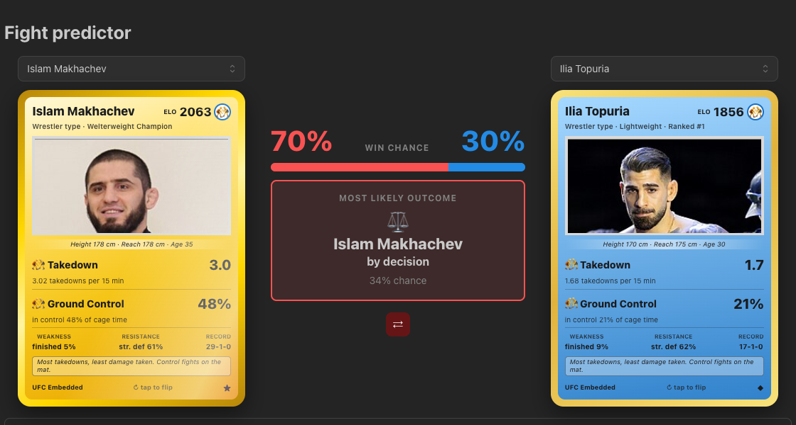
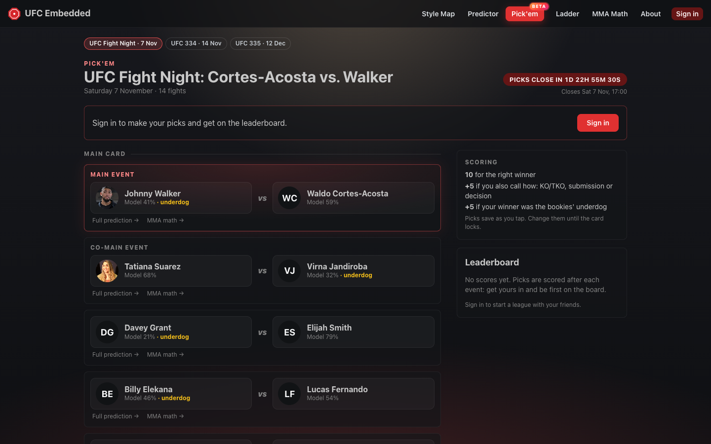
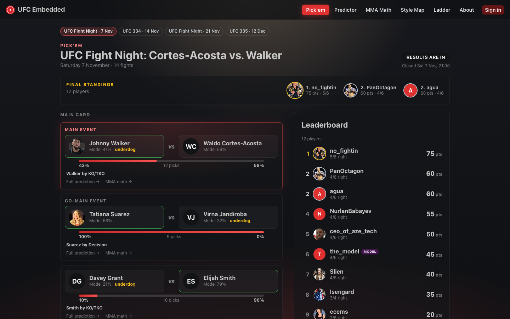
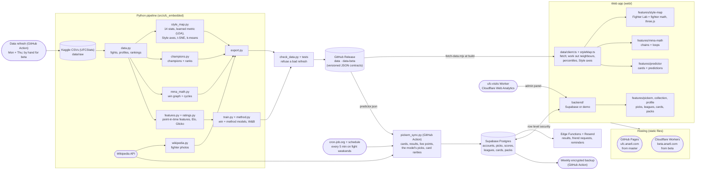

# UFC Embedded

Three decades of UFC fights, turned into machine learning models you can play with.

**Live:** https://ufc.anarli.com · **Details:** [docs/TECHNICAL.md](docs/TECHNICAL.md)

<table>
  <tr>
    <td width="50%" valign="top">
      <a href="https://ufc.anarli.com/fighter-lab"></a><br>
      <sub><b>Fighter Lab</b>: fighter math, and every active fighter in 3D by how they fight</sub>
    </td>
    <td width="50%" valign="top">
      <a href="https://ufc.anarli.com/predictor"></a><br>
      <sub><b>Fight Predictor</b>: win chance and how it ends</sub>
    </td>
  </tr>
  <tr>
    <td width="50%" valign="top">
      <a href="https://ufc.anarli.com"></a><br>
      <sub><b>Pick'em</b>: pick every fight on the next card, against friends and the model</sub>
    </td>
    <td width="50%" valign="top">
      <a href="https://ufc.anarli.com/?event=2026-11-07-ufc-fight-night"></a><br>
      <sub>After the fights: results live, the crowd's split, final standings</sub>
    </td>
  </tr>
</table>

More: [MMA Math](https://ufc.anarli.com/mma-math) (anyone "beats" anyone through a chain of
wins), the [Elo Ladder](https://ufc.anarli.com/ladder) and fighter cards that flip to a full
fighter file.

## Contents

- [Why](#why)
- [What's inside](#whats-inside)
- [The models](#the-models)
- [Architecture](#architecture)
- [Running it](#running-it)

## Why

Fight fans argue about styles, matchups and who would win, mostly on gut feeling. The data to
do better exists: UFCStats has every fight since 1994, round by round. This project is an
end-to-end attempt to turn that data into something useful and honest:

- **models that don't cheat:** every prediction uses only what was known before the fight;
- **an honest benchmark:** the betting market, which the models are measured against and
  don't beat;
- **a product people use:** a fast website, and a prediction game where friends play against
  each other and against the model on real cards.

## What's inside

| Page | What it does | Under the hood |
|---|---|---|
| [Fighter Lab](https://ufc.anarli.com/fighter-lab) | Fighter math (A − B + C = ?), ~700 active fighters in 3D, 5 most similar for each | 14 style stats, a learned metric (LDA), t-SNE, k-means |
| [Fight Predictor](https://ufc.anarli.com/predictor) | Win chance, method, what drives the call | Logistic regression on point-in-time features, Glicko ratings |
| [Pick'em](https://ufc.anarli.com) | Picks, leagues, live scoring, the model as a player | Supabase (Postgres, row level security), live sync from Wikipedia |
| [Elo Ladder](https://ufc.anarli.com/ladder) | Ratings next to official ranks | Elo from every UFC fight since 1994 |
| [MMA Math](https://ufc.anarli.com/mma-math) | Chains and loops of wins, shareable as an image | Win graph, cycle search, BFS in the browser |

## The models

**Fight predictor.** Two models, both deliberately simple: about 9,000 fights is too little for
deep nets, and gradient boosting did worse on the same features.

- **Who wins:** L2 logistic regression on the difference between the two fighters' features.
  It has no intercept, so P(A beats B) = 1 − P(B beats A) exactly.
- **How:** multinomial logistic regression for KO/TKO, submission or decision, given the
  winner.
- **Features:** experience, form, finishing rates, age, reach, per-minute striking and
  grappling rates, recent margins over opponents, a Glicko rating and strength of schedule.
  All are rebuilt from per-fight stats using only *earlier* fights, so nothing leaks from the
  future, and a test checks it.

Evaluated on time-based splits, each year 2019–23 predicted by a model trained on all earlier
years (2,457 fights):

| | Accuracy | Log loss ↓ | AUC |
|---|---|---|---|
| **Win model** (deployed) | **62.2%** | **0.652** | **0.661** |
| Elo | 55.5% | 0.685 | 0.578 |
| Betting market | 66.2% | 0.614 | 0.722 |


The model stays behind the market: bookmakers know about injuries, short notice and
debutants' careers before the UFC, which the stats don't.

**Fighter Lab.** Each fighter becomes a vector of 14 style stats (output, accuracy, where strikes
land, takedowns, control, submissions...), shrunk toward the average when based on little
data. How the stats combine is learned with linear discriminant analysis, every fighter a class:
stats that wobble from fight to fight count less, and overlapping ones aren't counted twice. It's
all linear, so fighters and styles can be added and subtracted (**fighter math**: "Topuria −
Volume boxers + Dominant wrestlers = ?"). Tested by splitting every career in two and finding the
other half: the learned embedding finds it in the top 10 for 36.8% of fighters (scored on
fighters it didn't learn from), against 32.9% before and 17.8% for UFCStats' own career averages.

All the details (features, evaluation, the style map pipeline, MMA math and Pick'em) are in
[docs/TECHNICAL.md](docs/TECHNICAL.md).

## Architecture

The Python pipeline runs on its own twice a week and publishes JSON to a GitHub Release; the
website is a static app that downloads it at build time and serves it from its own domain,
hosted free on GitHub Pages (beta on Cloudflare). Pick'em is the one live part: Supabase for
accounts, picks, scores and cards, kept up to date from Wikipedia by a scheduled sync.



## Running it

```bash
uv sync                                  # Python dependencies
node web/scripts/fetch-data.mjs          # the live site's data into web/public/data (not in git)
scripts/download-data.sh                 # or build your own: latest public datasets into data/raw
uv run python -m ufc_embedded.export     # style map + MMA math JSON
uv run python -m ufc_embedded.train      # train, evaluate (logged to W&B), write predictor.json
uv run pytest                            # Python tests

cd web && npm install
npm run dev                              # http://localhost:5173
VITE_ACCOUNTS=demo npm run dev           # with Pick'em on an in-browser demo backend
npm test                                 # web tests

supabase/tests/run.sh                    # database security tests (needs a local Postgres)
scripts/pickem-sync.sh                   # sync Pick'em cards and results now (needs SUPABASE_DB_URL in .env)
```

The site's data refreshes by itself twice a week, after each card and before the next
([details](docs/TECHNICAL.md#data)). Database setup is in [supabase/README.md](supabase/README.md).

Unofficial fan project, not affiliated with the UFC.
