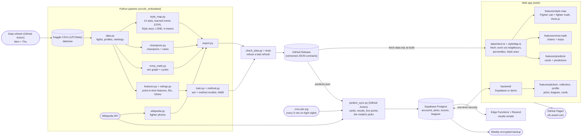
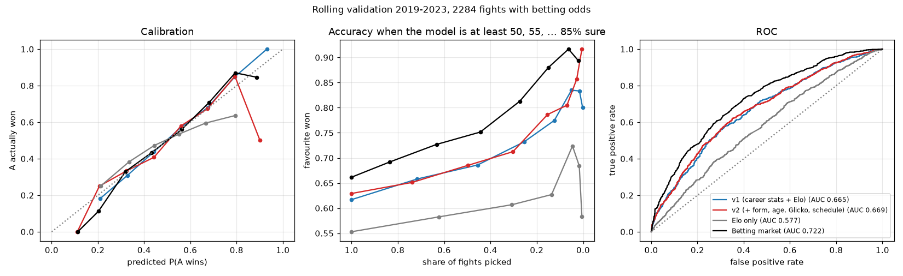

<h1 align="center"> UFC Embedded</h1>

<p align="center">Learning how fighters fight, and who wins, from three decades of UFC fights.</p>

<p align="center">
  <a href="https://ufc.anarli.com"></a>&nbsp;
  <a href="docs/TECHNICAL.md"></a>&nbsp;
  <a href="https://ufc.anarli.com/fighter-lab"></a>&nbsp;
  <a href="https://ufc.anarli.com/pickem"></a>
</p>

<p align="center">
  <a href="https://github.com/abbasly/ufc_embedded/actions/workflows/ci.yml"></a>
  <a href="https://github.com/abbasly/ufc_embedded/actions/workflows/data-refresh.yml"></a>
</p>

## Abstract

Two models learned from every UFC fight since 1994 (8,819 decisive fights, UFCStats):

- a **style embedding** of ~700 active fighters, a metric learned with LDA, which finds a
  fighter's held-out half career in the top 10 for 36.8% of fighters (17.8% for UFCStats'
  averages), and is linear, so styles can be added and subtracted ("fighter math");
- a **win model**, a leak-free logistic regression: 62.2% accuracy and 0.652 log loss on rolling
  2019–23 validation, against 66.2% and 0.614 for the betting market.

Five experiments (recency weighting, expert matchups, Bayesian networks, tree ensembles,
non-linear terms) did not beat the linear model. Both models run in a public website with a
prediction game against the model.

## Contents

1. [System architecture](#1-system-architecture)
2. [Data](#2-data)
3. [Style embedding](#3-style-embedding)
4. [Fight prediction](#4-fight-prediction)
5. [Experiments](#5-experiments)
6. [Limitations](#6-limitations)
7. [Reproducing](#7-reproducing)

## 1. System architecture

A Python pipeline rebuilds the data and models twice a week and publishes versioned JSON; the
static web app evaluates the models in the browser. Pick'em runs on Supabase, synced from
Wikipedia every 5 minutes on fight nights.



| Page | What it does | Method |
|---|---|---|
| [Fighter Lab](https://ufc.anarli.com/fighter-lab) | Fighter math (A − B + C = ?), ~700 fighters in 3D, the 5 most similar to each | Style embedding (§3), t-SNE, k-means |
| [Fight Predictor](https://ufc.anarli.com/predictor) | Win chance, method of victory, what drives the call | Win and method models (§4) |
| [Pick'em](https://ufc.anarli.com/pickem) | Pick every fight on the next card; leagues, live scoring, the model as a player | Supabase, Wikipedia sync |
| [Elo Ladder](https://ufc.anarli.com/ladder) | Ratings next to official ranks, the year's biggest movers | Elo over every UFC fight |
| [MMA Math](https://ufc.anarli.com/mma-math) | A chain of wins from any fighter to any other | Win graph, breadth-first search |

| Page | What it does | Method |
|---|---|---|
| [Fighter Lab](https://ufc.anarli.com/fighter-lab) | Fighter math, ~700 fighters in 3D, most similar fighters | Style embedding (§3) |
| [Fight Predictor](https://ufc.anarli.com/predictor) | Win chance and method of victory | Win and method models (§4) |
| [Pick'em](https://ufc.anarli.com/pickem) | Pick every fight on the next card, against friends and the model | Supabase |
| [Elo Ladder](https://ufc.anarli.com/ladder) | Ratings next to official ranks | Elo |
| [MMA Math](https://ufc.anarli.com/mma-math) | A chain of wins from any fighter to any other | Win graph, BFS |

## 2. Data

- **Fights:** UFCStats via public Kaggle datasets, per fight and per round.
- **Benchmark:** consensus bookmaker odds, margin removed (2,284 of 2,457 validation fights).
- **No leakage:** UFCStats' career stats are as of today, so every feature is rebuilt from
  earlier fights only (tested). The winner is always listed first, so corners are swapped at
  random.

## 3. Style embedding

**Statistics.** Each fighter $f$ gets 14 career statistics (output, defence, takedowns, control,
where strikes land…), each a ratio of totals over their fights, shrunk toward the population
rate $r_0$ by a pseudo-count $k$ (e.g. 5 takedown attempts):

$$\hat r_f = \frac{\text{num}_f + k\, r_0}{\text{den}_f + k},$$

so 1 takedown in 1 attempt reads as about average, 50 in 50 stays high. Skewed rates get
$\log(1+x)$; all 14 are standardised into $x_f \in \mathbb{R}^{14}$.

**Learned metric (LDA).** Plain Euclidean distance on $x$ treats all 14 statistics as equally
reliable and independent; they are neither. Split each fighter's fights into two halves (alternating
fights, and four random splits), giving profiles $x_f^{(1)}, x_f^{(2)}$. Then

$$\Sigma_\text{noise} = \operatorname{Cov}_f\!\left(\frac{x_f^{(1)} - x_f^{(2)}}{\sqrt 2}\right),
\qquad \Sigma_\text{signal} = \operatorname{Cov}_f\big(x_f\big),$$

how much a fighter's own numbers wobble (the $\sqrt 2$ because a difference of two noisy halves
has twice the variance), and how much fighters differ from each other. The best directions
maximise signal over noise,

$$\max_w \frac{w^\top \Sigma_\text{signal}\, w}{w^\top \Sigma_\text{noise}\, w}
\;\Longrightarrow\; \Sigma_\text{signal}\, w = \lambda\, \Sigma_\text{noise}\, w,$$

a generalised eigenproblem: linear discriminant analysis with every fighter as a class. All 14
eigenvectors form $W$, scaled so that $W^\top \Sigma_\text{noise} W = I$, and the embedding is
$z_f = x_f W$. Since then $W W^\top = \Sigma_\text{noise}^{-1}$,

$$\lVert z_a - z_b \rVert^2 = (x_a - x_b)^\top\, \Sigma_\text{noise}^{-1}\, (x_a - x_b):$$

the Mahalanobis distance in units of fight-to-fight noise. Statistics that wobble within a
fighter count less, and correlated ones (takedowns and control time) are not counted twice.
Each $\lambda$ is the signal-to-noise ratio of its direction.

**Evaluation.** Find each fighter's held-out half among everyone's other halves (517 fighters),
with $W$ learned without the fighters being tested (5-fold).

| Find the held-out half career | Top 1 | Top 10 | Median rank |
|---|---|---|---|
| UFCStats career averages | 3.9% | 17.8% | 70 |
| 14 statistics | 10.1% | 28.2% | 38 |
| **14 statistics, learned metric** | **15.1%** | **36.8%** | **22** |

**Fighter math.** A style is the mean of its fighters, $\mu_s$. A sum is computed on the
statistics and answered with the nearest real fighter in the embedding, the terms excluded:

$$v = x_\text{Topuria} - \mu_\text{volume boxers} + \mu_\text{wrestlers},
\qquad \text{answer} = \arg\min_{f} \lVert (x_f - v)\, W \rVert.$$

This only means something because $x \mapsto xW$ is linear. Similarity scores are
$100\,(1 - d / d_\text{median})$, clipped to 0–100.

**Styles.** k-means ($k = 5$) on $z$. The silhouette is ≈ 0.12 for every $k$: styles are a
continuum, and $k = 5$ was chosen for readability.

## 4. Fight prediction

- **Features:** 46 per fighter, from earlier fights only: record, age, reach, shrunk striking and
  grappling rates, recent form, Glicko rating and uncertainty, strength of schedule.
- **Win model:** $P(A \text{ beats } B) = \sigma\big(w^\top (x_A - x_B)\big)$, L2, no intercept,
  so $P(A) = 1 - P(B)$ exactly.
- **Method model:** multinomial logistic regression for KO / submission / decision.
- **Evaluation:** time splits only; each year 2019–23 predicted from earlier years; 2024+ locked.

| Rolling 2019–23 | Accuracy | Log loss ↓ | AUC |
|---|---|---|---|
| **Win model** | **62.2%** | **0.652** | **0.661** |
| Elo | 55.5% | 0.685 | 0.578 |
| Betting market | 66.2% | 0.614 | 0.722 |



## 5. Experiments

Same rolling validation, tuned per variant, 95% bootstrap intervals; the test set stays locked.
Figures are in [docs/experiments](docs/experiments), every run is logged to W&B.

| Experiment | Best log loss ↓ | vs deployed (95% interval) |
|---|---|---|
| Deployed linear model | 0.6513 | |
| **5.1** Recent fights weighted more | 0.6507 | +0.0007 (−0.0015, +0.0028) |
| **5.2** Expert matchup features | 0.6511 | +0.0002 (−0.0010, +0.0013) |
| **5.3** Tree-augmented naive Bayes | 0.6608 | −0.0094 (−0.0166, −0.0026) |
| **5.4** Gradient boosting | 0.6552 | −0.0040 (−0.0085, +0.0006) |
| **5.4** Random forest | 0.6563 | −0.0051 (−0.0100, +0.0001) |
| **5.5** Spline curves per feature | 0.6525 | −0.0014 (−0.0050, +0.0020) |

- **5.1 Time.** The sport changed (output doubled, clinch and ground striking fell to a quarter),
  but both fighters come from the same era, so it cancels in the differences.
  [Code](src/ufc_embedded/recency.py) · [plot](docs/experiments/recency-style_drift.png)
- **5.2 Matchups.** Wrestling vs takedown defence, power vs chin, "striking if it stays
  standing": predictive alone, already captured by the linear model.
  [Code](src/ufc_embedded/matchups_experiment.py)
- **5.3 Bayesian networks.** Naive Bayes double-counts correlated features (log loss 1.18); a
  learned dependency tree fixes much of it, not enough.
  [Code](src/ufc_embedded/matchups_experiment.py) · [learned DAG](docs/experiments/matchups-tan-dag.png)
- **5.4 Trees.** The best boosting uses depth-1 trees (no interactions); deeper trees do worse.
  [Code](src/ufc_embedded/trees_experiment.py)
- **5.5 Non-linear terms.** Squares, cubes, splines and interactions all lose; the learned
  curves are nearly straight. [Code](src/ufc_embedded/polynomial_experiment.py)

**Conclusion:** with ~6,000 training fights the signal is additive and linear. The gap to the
market is information the statistics lack (injuries, camps, short notice, pre-UFC careers).

## 6. Limitations

- UFCStats records where a strike lands, not which strike (a calf kick is just a leg kick).
- Newcomers' pre-UFC careers are missing; fighters with few UFC fights are mostly their prior.
- Gym and camp aren't modelled: sources list teams without dates, which would leak.

## 7. Reproducing

```bash
uv sync && scripts/download-data.sh               # dependencies and public datasets
uv run python -m ufc_embedded.style_map            # §3
uv run python -m ufc_embedded.train                # §4 (W&B)
uv run python -m ufc_embedded.recency              # §5.1; also matchups_experiment,
                                                   # trees_experiment, polynomial_experiment
uv run pytest

cd web && npm install && node scripts/fetch-data.mjs
npm run dev                                        # http://localhost:5173
VITE_ACCOUNTS=demo npm run dev                     # Pick'em with a demo backend
```

More: [docs/TECHNICAL.md](docs/TECHNICAL.md) · database: [supabase/README.md](supabase/README.md)

Unofficial fan project, not affiliated with the UFC.
