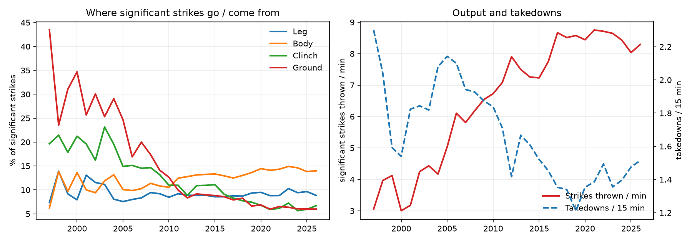
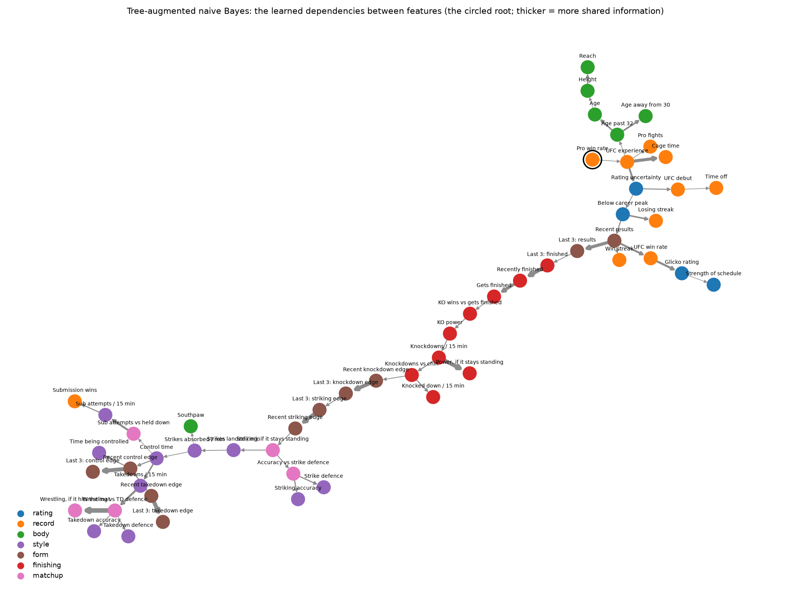

<h1 align="center"> UFC Embedded</h1>

<p align="center">Learning how fighters fight, and who wins, from three decades of UFC fights.</p>

<p align="center">
  <a href="https://ufc.anarli.com"></a>&nbsp;
  <a href="docs/TECHNICAL.md"></a>&nbsp;
  <a href="https://ufc.anarli.com/fighter-lab"></a>&nbsp;
  <a href="https://ufc.anarli.com/pickem"></a>
</p>

<p align="center">
  <a href="https://github.com/abbasly/ufc_embedded/actions/workflows/ci.yml"></a>
  <a href="https://github.com/abbasly/ufc_embedded/actions/workflows/data-refresh.yml"></a>
</p>

## Abstract

UFC Embedded learns from every UFC fight since 1994 (8,819 decisive fights, round-by-round
statistics from UFCStats). It has two models. First, a **style embedding** of ~700 active
fighters: a linear metric, learned with linear discriminant analysis (every fighter a class), in
which a fighter's own fights lie close together. It finds a fighter's held-out half career in the
top 10 for 36.8% of fighters (from 517 candidates), against 17.8% for UFCStats' career averages.
Because the embedding is linear, styles can be added and subtracted ("fighter math"). Second, a
**win-probability model**: a logistic regression on point-in-time feature differences, built so
that nothing from after a fight leaks into its prediction. On rolling yearly validation
(2019–23) it reaches 62.2% accuracy and a log loss of 0.652, against 66.2% and 0.614 for the
betting market, which has information the statistics lack. Experiments with recency weighting,
expert matchup features and Bayesian network classifiers did not improve on it. Both models run
in a public website, including a prediction game in which players compete against the model on
real cards.

## Contents

1. [System architecture](#1-system-architecture)
2. [Data](#2-data)
3. [Style embedding](#3-style-embedding)
4. [Fight prediction](#4-fight-prediction)
5. [Experiments](#5-experiments)
6. [Limitations and future work](#6-limitations-and-future-work)
7. [Reproducing](#7-reproducing)

## 1. System architecture

A Python pipeline turns public datasets into versioned JSON. It runs by itself twice a week
(after each card, and before the next) and refuses to publish if data checks or tests fail. The
website is a static React app that downloads the JSON at build time and evaluates the models in
the browser, so no model server is needed. The one live part is Pick'em, the prediction game:
Supabase (Postgres with row-level security) holds accounts, picks and scores, and a sync job
reads cards and results from Wikipedia every 5 minutes on fight nights.


| Page | What it does | Method |
|---|---|---|
| [Fighter Lab](https://ufc.anarli.com/fighter-lab) | Fighter math (A − B + C = ?), ~700 fighters in 3D, the 5 most similar to each | Style embedding (§3), t-SNE, k-means |
| [Fight Predictor](https://ufc.anarli.com/predictor) | Win chance, method of victory, what drives the call | Win and method models (§4) |
| [Pick'em](https://ufc.anarli.com/pickem) | Pick every fight on the next card; leagues, live scoring, the model as a player | Supabase, Wikipedia sync |
| [Elo Ladder](https://ufc.anarli.com/ladder) | Ratings next to official ranks, the year's biggest movers | Elo over every UFC fight |
| [MMA Math](https://ufc.anarli.com/mma-math) | A chain of wins from any fighter to any other | Win graph, breadth-first search |

## 2. Data

- **Fights:** every UFC fight from UFCStats via public Kaggle datasets: per-fight and per-round
  totals for both fighters (significant strikes by target and position, takedowns, control time,
  knockdowns, submission attempts), plus results, method, and fighter height, reach, age and stance.
- **Benchmark:** consensus bookmaker odds with the margin removed, for 2,284 of the 2,457
  validation fights.
- **Context:** official rankings, fighter photos under free licences from Wikipedia, and
  upcoming cards from Wikipedia.

Two traps in the raw data matter for prediction. UFCStats' career statistics and records are as
of *today*, so using them for past fights would leak the results; every feature is therefore
rebuilt from per-fight statistics using only fights on earlier dates, and a test checks that
changing a later fight changes no earlier feature. The raw data also always lists the winner
first, so the two corners are randomly swapped.

## 3. Style embedding

**Statistics.** Each fighter is described by 14 career statistics: output, strikes absorbed,
accuracy, defence, knockdowns, takedowns, takedown accuracy and defence, control time,
submission attempts, and the share of strikes to the body and legs and from the clinch and the
ground. Each is a ratio of totals over the career, shrunk toward the population rate by a
pseudo-count (for example 5 takedown attempts), so a 1-for-1 takedown record reads as about
average. Skewed rates are log-transformed and all 14 are standardised.

**Learned metric.** Euclidean distance on these 14 numbers treats every statistic as equally
reliable and independent; they are neither. Each fighter's fights are split into two halves
(alternating, and four random splits). The difference between halves estimates within-fighter
noise $\Sigma_\text{noise}$; the spread of whole careers estimates the signal $\Sigma_\text{signal}$.
The embedding $z = xW$ solves the generalised eigenproblem
$\Sigma_\text{signal} w = \lambda\, \Sigma_\text{noise} w$ (linear discriminant analysis with every
fighter as a class), so that distances are measured in units of fight-to-fight noise. Statistics
that vary within a fighter count less, and correlated ones (takedowns and control time) are not
counted twice.

**Evaluation.** A profile from half of a fighter's fights is used to find the other half among all
fighters, with the metric learned on other fighters (5-fold).

| Embedding | Top 1 | Top 10 | Median rank | Last 3 fights: top 10 |
|---|---|---|---|---|
| UFCStats career averages (8) | 3.9% | 17.8% | 70 | |
| 14 statistics | 10.1% | 28.2% | 38 | |
| 14 statistics, stability-weighted | 10.8% | 32.9% | 27 | 23.7% |
| **14 statistics, learned metric** | **15.1%** | **36.8%** | **22** | **25.7%** |

**Styles and fighter math.** k-means (k = 5) on the embedding gives the five styles shown on the
site. The silhouette score is about 0.12 for every k: styles form a continuum rather than
separate clusters, and k = 5 was chosen for readability. Because the embedding is linear, a sum
such as "Topuria − Volume boxers + Dominant wrestlers" (a style being the mean of its fighters)
is computed on the statistics and answered with the nearest real fighter.

## 4. Fight prediction

**Features.** For each fighter, 46 features from earlier fights only: experience and record
(including the pre-UFC record), age with an age curve, reach, shrunk per-minute rates for
striking, grappling and knockdowns, recent form (exponentially weighted and last-3 margins over
opponents), a Glicko rating with its uncertainty, strength of schedule and distance from career
peak.

**Win model.** An L2-regularised logistic regression on the differences between the two fighters,

$$P(A \text{ beats } B) = \sigma\big(w^\top (x_A - x_B)\big),$$

without an intercept, so $P(A \text{ beats } B) = 1 - P(B \text{ beats } A)$ exactly. **Method
model:** a multinomial logistic regression for KO/TKO, submission or decision given the winner
(log loss 0.990 against 1.041 for the base rates).

**Evaluation.** Splits are by time only. Models are compared on rolling validation, each year
2019–23 predicted by a model trained on all earlier years (2,457 fights); fights from 2024 on
are a test set kept locked. Log loss is the main metric (0.693 for a coin flip).

| Rolling 2019–23 | Accuracy | Log loss ↓ | AUC |
|---|---|---|---|
| **Win model** (deployed) | **62.2%** | **0.652** | **0.661** |
| Win model without form, Glicko and schedule (v1) | 61.1% | 0.654 | 0.657 |
| Gradient boosting, same features | | 0.659 | |
| Elo | 55.5% | 0.685 | 0.578 |
| Betting market (2,284 fights with odds) | 66.2% | 0.614 | 0.722 |


The gap to the market is information the statistics do not contain: injuries, short-notice
replacements, weight cuts, training camps, and newcomers' careers before the UFC.

## 5. Experiments

All experiments use the rolling validation of §4, tune regularisation per variant, and report the
gain over the deployed model with a 95% paired bootstrap interval over fights. None used the
locked test set.

**5.1 Does the sport change over time?** It does. Since the late 1990s, output has roughly
doubled (from ~4 to ~8.5 significant strikes thrown per minute), and ground and clinch striking
have fallen from about 40% and 20% of significant strikes to about 6% each. The weight the model
gives each feature also moves: fit on 4-year windows, reach mattered far more in 2005–08 than it
does now. Yet weighting recent fights more (half-lives of 2–16 years) or training on recent
years only did not improve the model (best: 0.6507 against 0.6513, interval
[−0.0015, 0.0028]). Both fighters in a fight come from the same era, so shifts across the
sport largely cancel in the differences. Code: [`recency.py`](src/ufc_embedded/recency.py).



**5.2 Expert matchup features.** The deployed model compares each fighter's own numbers and so
cannot express matchups. Added features (each $f(A,B) - f(B,A)$, keeping the symmetry): wrestling
against takedown defence, power against how often the opponent is dropped or finished,
submissions against time spent held down, and a "stays standing" probability from both
fighters' takedown threat, multiplied by the striking and power differences. *Striking if it
stays standing* is among the strongest features on its own, and *wrestling against takedown
defence* gets real weight, but the full model already captured the same information: 0.6511,
interval [−0.0010, 0.0013], with slightly better calibration. Giving finishing features (gets
finished, knocked down, KO power) less regularisation did not help either. Code:
[`matchups_experiment.py`](src/ufc_embedded/matchups_experiment.py).

**5.3 Bayesian network classifiers.** Gaussian naive Bayes treats the features as independent
given the winner; many are near-duplicates, so it counts the same evidence repeatedly and is
badly overconfident (log loss 1.18 on all inputs). Tree-augmented naive Bayes, which learns a
dependency tree between the features (Chow–Liu on conditional mutual information), recovers
much of this (0.72), and with 8 weakly correlated inputs reaches 0.661, still behind the
logistic regression. The learned tree recovers sensible groups unaided: body measurements,
record and experience, a finishing chain and separate striking and wrestling chains.



| Rolling 2019–23 | Log loss ↓ | Gain over deployed (95% interval) |
|---|---|---|
| Deployed win model | 0.6513 | |
| Recent fights weighted more (half-life 4 years) | 0.6507 | +0.0007 (−0.0015, +0.0028) |
| Last 3 years only | 0.6539 | −0.0025 (−0.0073, +0.0020) |
| + matchup and "stays standing" features | 0.6511 | +0.0002 (−0.0010, +0.0013) |
| Finishing features less regularised (3×) | 0.6514 | −0.0001 (−0.0006, +0.0005) |
| Tree-augmented naive Bayes, 8 inputs | 0.6608 | −0.0094 (−0.0166, −0.0026) |
| Naive Bayes, all inputs | 1.1789 | −0.527 (−0.588, −0.468) |

## 6. Limitations and future work

- About 9,000 fights limit what any model can learn; with this little signal per fight, simple
  linear models beat flexible ones.
- UFCStats records where a strike lands, not which strike: a calf kick and any other leg kick look
  the same.
- Fighters with few UFC fights are mostly their prior; newcomers' earlier careers are missing.
- Gym and training camp are not modelled: the available sources list a fighter's teams without
  dates, which would leak information into past fights.

## 7. Reproducing

```bash
uv sync                                          # Python dependencies
scripts/download-data.sh                         # public datasets into data/raw
uv run python -m ufc_embedded.style_map          # style embedding evaluation (§3)
uv run python -m ufc_embedded.export             # style map + MMA math JSON
uv run python -m ufc_embedded.train              # train and evaluate (§4), logged to W&B
uv run python -m ufc_embedded.recency            # experiment 5.1
uv run python -m ufc_embedded.matchups_experiment  # experiments 5.2 and 5.3
uv run pytest                                    # Python tests

cd web && npm install
node scripts/fetch-data.mjs                      # or the live site's data
npm run dev                                      # http://localhost:5173
VITE_ACCOUNTS=demo npm run dev                   # Pick'em on an in-browser demo backend
npm test
```

Database setup and security tests: [supabase/README.md](supabase/README.md). Data refresh and
deployment: [docs/TECHNICAL.md](docs/TECHNICAL.md#data).

Unofficial fan project, not affiliated with the UFC.
