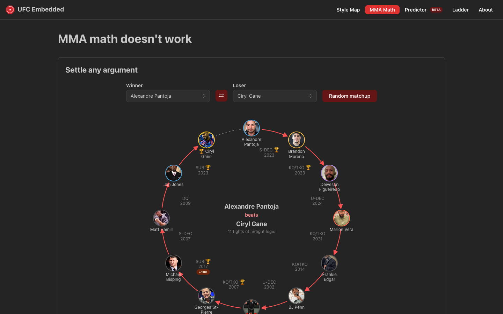
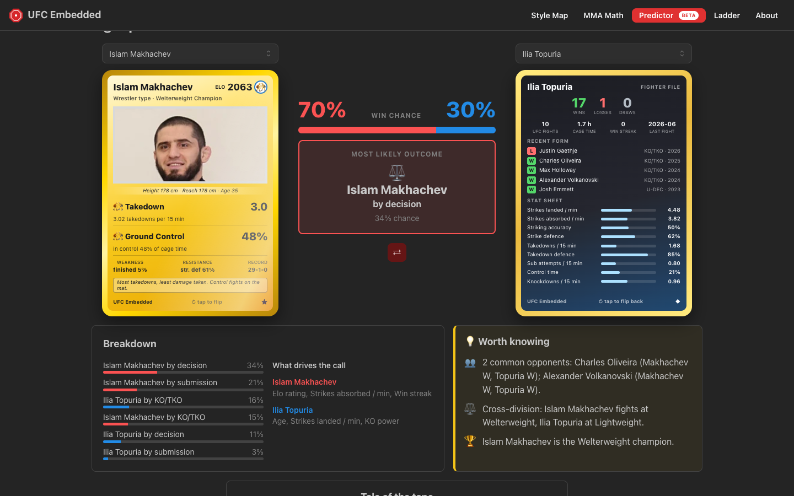
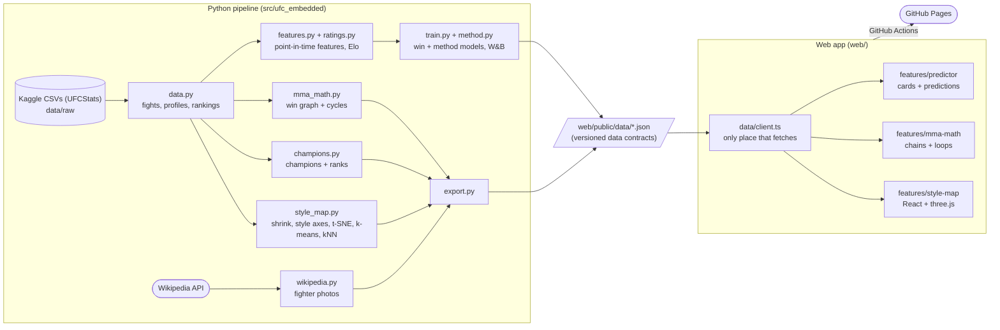

# UFC Embedded

Every active UFC fighter, mapped by how they fight.

**Live:** https://abbasly.github.io/ufc_embedded/

A personal ML engineering project: turn fight statistics into interactive, explorable models.
Data is current to the latest UFC event (fights, records, rankings and odds from UFCStats and
bookmakers, via Kaggle). Works on desktop and phone.

### [Style Map](https://abbasly.github.io/ufc_embedded/)

~700 active fighters placed in 3D by how they fight. Click anyone for their W-L-D record, stats,
current ranking and closest look-alikes. Switch between readable style axes and a t-SNE
similarity view; filter by style, weight class, champions or ranked fighters.


### [MMA Math](https://abbasly.github.io/ufc_embedded/mma-math)

Loops of fighters who beat each other in a circle (A beat B, B beat C, C beat A), and a
calculator that "proves" any fighter beats any other with a chain of wins, drawn as a circle.



### [Fight Predictor](https://abbasly.github.io/ufc_embedded/predictor) (beta)

Pick two fighters and get the verdict right between them: win chances and the most likely
outcome (who, and by KO / submission / decision). Fighters are collectible-style cards: style =
card type, Elo where the HP would be, signature stats as moves, gold holo cards for champions.
Tap a card and it flips to a "fighter file" with the record, recent form and a full stat sheet.
Below: every outcome's probability, what drives the call, notes like past meetings and common
opponents, and a tale of the tape.




### [Elo Ladder](https://abbasly.github.io/ufc_embedded/ladder)

Every fighter rated chess-style from every UFC fight since 1994 (start at 1500, the winner takes
points from the loser, K = 100 tuned on validation), filterable by division and activity, next
to their official UFC rank and their change over the last 12 months. Side panels: biggest
climbers, biggest drops, and the highest-rated fighters without an official ranking.

## How the style map works

1. Take fighters active in the last 3 years with at least 3 UFC fights (~700).
2. Use 8 UFCStats career rates (strikes landed/absorbed, accuracy, defence, takedowns,
   takedown accuracy/defence, submission attempts).
3. **Shrink** noisy stats toward the average, more for fighters with little cage time or few
   attempts (a 100% takedown accuracy from 1 attempt shouldn't count), then log-transform the
   skewed rates and standardise.
4. Two layouts:
   - **Style axes:** hand-defined Grappling, Striking and Defence scores (weighted stat averages),
     readable by construction. PCA/varimax axes were tried first, but the data's strongest
     pattern is "accuracy", which made them hard to name.
   - **Similarity:** t-SNE, which keeps far more true neighbours together but has meaningless axes.

   Each layout reports how many of every fighter's 10 nearest neighbours (in the full 8-stat
   space) it keeps: about 21% for style axes vs 51% for t-SNE in 3D.
5. k-means for style groups, nearest neighbours in the full stat space for "most similar".
6. Current champions and rankings come from the official rankings; fighter photos (free licences
   only, about a third of fighters) from Wikipedia.

## How MMA math works

1. Every decisive UFC fight since 1994 is an edge from winner to loser (draws and no contests
   are skipped). Fighters are identified by their UFCStats id, so namesakes stay apart.
2. Simple cycles of 3 to 5 fighters are found with networkx and ranked by the "fame" of the
   least known fighter in the loop (UFC fights, title wins, current belt).
3. The calculator runs a breadth-first search in the browser for the shortest chain of wins
   from one fighter to another, drawn as a circle (⇄ swaps the direction). Over 1,200 fighters form one strongly connected component, so within it
   anyone "beats" anyone.

## How the predictor works

**Data without leakage.** UFCStats career stats and W-L-D records are *as of today*, so using
them to predict past fights would leak the results. Every feature is rebuilt from per-fight
stats using only fights on *earlier dates* (`features.py`), and a test checks that changing a
future fight changes no earlier feature. The raw data also always lists the winner first, so
fighters are randomly assigned to corners A and B.

**Features (28 per fighter, plus Elo).** Experience (UFC fights, cage minutes), form (win rate,
win / loss streaks), finishing (KO and submission win rates, how often they get finished), pro
record going in, age, layoff, height, reach, stance, and shrunk per-minute rates for striking,
defence, takedowns, submissions, control time and knockdowns. Elo is computed online through
fight history, so it's always the rating going *into* a fight.

**Models** (`train.py`, all deliberately simple: ~9k fights is too little for deep nets):

| Model | What it is |
|---|---|
| Betting market | Consensus bookmaker odds with the margin (vig) removed: the benchmark |
| Elo | Online rating, K tuned on validation |
| **Win model** | L2 logistic regression on A − B feature differences (+ Elo), no intercept, so P(A beats B) = 1 − P(B beats A) exactly |
| **Method model** | Multinomial logistic regression for KO/TKO vs submission vs decision *given the winner*, from the winner's finishing profile, the loser's durability and the weight class |

**Evaluation.** Split by time: train ≤ 2021, tune on 2022–23, and the 2024+ test set stays
locked until a final run (`--final`). Validation results on the same 896 fights:

| | Accuracy | Log loss ↓ | Brier ↓ |
|---|---|---|---|
| Betting market | 69.0% | 0.596 | 0.205 |
| **Win model** | **63.2%** | **0.645** | **0.227** |
| Elo | 55.4% | 0.682 | 0.244 |
| Coin flip | 50% | 0.693 | 0.250 |

Method model: log loss 0.990 vs 1.041 for always predicting the base rates. Everything (sweep
curves, calibration plots, feature weights, worst misses, disagreements with the market, an Elo
leaderboard and the dataset) is logged to Weights & Biases.

**Reality check.** Scored with pre-fight data only, the model got 5 of 14 winners right at
UFC 333 (2026-10-24), including both headliners wrong. One card is a small sample, but it shows
what career averages miss (rematches, decline with age, short UFC records). Hence "beta".

**In the browser.** `train.py` exports the deployed weights (fit on fights before 2024) and
every active fighter's features as of today to `predictor.json`; the page evaluates both models
client-side, no server needed.

## Architecture

The Python side runs offline and writes JSON files; the website is a separate static app
that only reads them. No server needed, so it hosts for free on GitHub Pages.



- **Data contract:** `export.py` writes JSON with a `schema_version`; `web/src/data/types.ts`
  mirrors it. Moving to a real API later only changes `client.ts`.
- **Features are modular:** each product lives in `web/src/features/<name>/` and is lazy-loaded
  by its route.
- **CI/CD:** every push to `master` runs ruff, mypy, pytest, the web tests and build, then deploys.

## Stack

Python 3.12 with uv, pandas, scikit-learn, networkx; ruff, mypy (strict), pytest.
Web: Vite, React, TypeScript, Mantine, react-three-fiber/drei, TanStack Query; vitest.

## Running it

```bash
uv sync                                  # Python deps
uv run python -m ufc_embedded.export     # rebuild style map + MMA math JSON
uv run python -m ufc_embedded.train      # train predictor models, log to W&B, write predictor.json
uv run pytest                            # Python tests

cd web && npm install
npm run dev                              # http://localhost:5173
npm test                                 # web tests
```

Raw data isn't committed. Download these regularly updated Kaggle datasets into
`data/raw/<dataset-name>/` (no account needed for public datasets):

| Dataset | Used for |
|---|---|
| [`scarekrow/ufc-data`](https://www.kaggle.com/datasets/scarekrow/ufc-data) | Every UFC fight (UFCStats), fighter records and career stats |
| [`valihameed/ufc-stats`](https://www.kaggle.com/datasets/valihameed/ufc-stats) | Betting odds up to 2024 (MMA math upsets, market baseline fallback) |
| [`jerzyszocik/ufc-betting-odds-daily-dataset`](https://www.kaggle.com/datasets/jerzyszocik/ufc-betting-odds-daily-dataset) | Betting odds keyed by UFCStats ids, incl. 2025+ (market baseline) |
| [`jerzyszocik/ufc-rankings-history`](https://www.kaggle.com/datasets/jerzyszocik/ufc-rankings-history) | Official rankings and current champions |

```bash
for ds in scarekrow/ufc-data valihameed/ufc-stats jerzyszocik/ufc-rankings-history \
          jerzyszocik/ufc-betting-odds-daily-dataset; do
  n=$(basename $ds); [ $n = ufc-betting-odds-daily-dataset ] && n=ufc-betting-odds; mkdir -p data/raw/$n
  curl -sSL "https://www.kaggle.com/api/v1/datasets/download/$ds" -o /tmp/$n.zip && unzip -oq /tmp/$n.zip -d data/raw/$n
done
```

Fighter photos are cached in `data/processed/fighter_photos*.json`; delete them to refresh.

## Limitations

- Career averages hide style changes over time; fighters with few fights are noisy.
- Only the 8 career rates are used so far. The fight data also has per-round strikes by target
  (head/body/leg) and position (distance/clinch/ground) and control time: the next step for a
  richer embedding.
- Rankings and champions are matched to fighters by name, so namesakes could be confused.

Unofficial fan project, not affiliated with the UFC.
