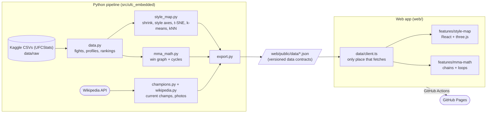

# UFC Embedded

Every active UFC fighter, mapped by how they fight.

**Live:** https://abbasly.github.io/ufc_embedded/

A personal ML engineering project: turn fight statistics into interactive, explorable models.
The first product is the **Style Map**, a 3D embedding of ~500 active fighters where similar
styles sit close together. Click a fighter to see their profile and the fighters most like them.

**MMA Math** finds loops of fighters who beat each other in a circle (A beat B, B beat C, C beat A)
and "proves" any fighter beats any other with a chain of wins. Hover anyone to see their style profile.

Planned next: a probabilistic **fight predictor** (Bayesian skill ratings with uncertainty,
checked against betting odds) and, as a stretch, a browser **shadowboxing coach**.

## How the style map works

1. Take fighters active in the last 3 years with at least 3 UFC fights.
2. Use 8 UFCStats career rates (strikes landed/absorbed, accuracy, defence, takedowns,
   takedown accuracy/defence, submission attempts).
3. **Shrink** noisy stats toward the average, more for fighters with little cage time or few
   attempts (a 100% takedown accuracy from 1 attempt shouldn't count), then log-transform the
   skewed rates and standardise.
4. Two layouts:
   - **Style axes:** hand-defined Grappling, Striking and Defence scores (weighted stat averages),
     readable by construction. PCA/varimax axes were tried first, but the data's strongest
     pattern is "accuracy", which made them hard to name.
   - **Similarity:** t-SNE, which keeps far more true neighbours together but has meaningless axes.

   Each layout reports how many of every fighter's 10 nearest neighbours (in the full 8-stat
   space) it keeps: about 25% for style axes vs 52% for t-SNE in 3D.
5. k-means for style groups, nearest neighbours in the full stat space for "most similar".
6. Current champions and fighter photos (free licences only, ~40% of fighters) come from Wikipedia.

## Architecture

The Python side runs offline and writes JSON files; the website is a separate static app
that only reads them. No server needed, so it hosts for free on GitHub Pages.



- **Data contract:** `export.py` writes JSON with a `schema_version`; `web/src/data/types.ts`
  mirrors it. Moving to a real API later only changes `client.ts`.
- **Features are modular:** each product lives in `web/src/features/<name>/` and is lazy-loaded
  by its route.
- **CI/CD:** every push to `master` runs ruff, mypy, pytest, the web tests and build, then deploys.

## Stack

Python 3.12 with uv, pandas, scikit-learn, networkx; ruff, mypy (strict), pytest.
Web: Vite, React, TypeScript, Mantine, react-three-fiber/drei, TanStack Query; vitest.

## Running it

```bash
uv sync                                  # Python deps
uv run python -m ufc_embedded.export     # rebuild web/public/data/*.json
uv run pytest                            # Python tests

cd web && npm install
npm run dev                              # http://localhost:5173
npm test                                 # web tests
```

Raw data isn't committed. Download these regularly updated Kaggle datasets into
`data/raw/<dataset-name>/` (no account needed for public datasets):

| Dataset | Used for |
|---|---|
| [`scarekrow/ufc-data`](https://www.kaggle.com/datasets/scarekrow/ufc-data) | Every UFC fight (UFCStats), fighter records and career stats |
| [`valihameed/ufc-stats`](https://www.kaggle.com/datasets/valihameed/ufc-stats) | Betting odds (for MMA math upsets) |
| [`jerzyszocik/ufc-rankings-history`](https://www.kaggle.com/datasets/jerzyszocik/ufc-rankings-history) | Official rankings and current champions |

```bash
for ds in scarekrow/ufc-data valihameed/ufc-stats jerzyszocik/ufc-rankings-history; do
  n=$(basename $ds); mkdir -p data/raw/$n
  curl -sSL "https://www.kaggle.com/api/v1/datasets/download/$ds" -o /tmp/$n.zip && unzip -oq /tmp/$n.zip -d data/raw/$n
done
```

Fighter photos are cached in `data/processed/fighter_photos.json`; delete it to refresh.

## Limitations

- Career averages hide style changes over time; fighters with few fights are noisy.
- Only the 8 career rates are used so far. The fight data also has per-round strikes by target
  (head/body/leg) and position (distance/clinch/ground) and control time: the next step for a
  richer embedding.
- Rankings and champions are matched to fighters by name, so namesakes could be confused.

Unofficial fan project, not affiliated with the UFC.
