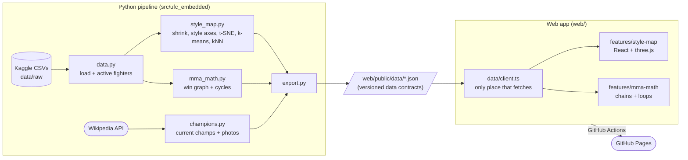

# UFC Embedded

Every active UFC fighter, mapped by how they fight.

**Live:** https://abbasly.github.io/ufc_embedded/

A personal ML engineering project: turn fight statistics into interactive, explorable models.
The first product is the **Style Map**, a 3D embedding of ~500 active fighters where similar
styles sit close together. Click a fighter to see their profile and the fighters most like them.

**MMA Math** finds loops of fighters who beat each other in a circle (A beat B, B beat C, C beat A)
and "proves" any fighter beats any other with a chain of wins. Hover anyone to see their style profile.

Planned next: a probabilistic **fight predictor** (Bayesian skill ratings with uncertainty,
checked against betting odds) and, as a stretch, a browser **shadowboxing coach**.

## How the style map works

1. Take fighters active in the last 3 years with at least 3 UFC fights.
2. Use 8 UFCStats career rates (strikes landed/absorbed, accuracy, defence, takedowns,
   takedown accuracy/defence, submission attempts).
3. **Shrink** noisy stats toward the average, more for fighters with little cage time or few
   attempts (a 100% takedown accuracy from 1 attempt shouldn't count), then log-transform the
   skewed rates and standardise.
4. Two layouts:
   - **Style axes:** hand-defined Grappling, Striking and Defence scores (weighted stat averages),
     readable by construction. PCA/varimax axes were tried first, but the data's strongest
     pattern is "accuracy", which made them hard to name.
   - **Similarity:** t-SNE, which keeps far more true neighbours together but has meaningless axes.

   Each layout reports how many of every fighter's 10 nearest neighbours (in the full 8-stat
   space) it keeps: about 25% for style axes vs 52% for t-SNE in 3D.
5. k-means for style groups, nearest neighbours in the full stat space for "most similar".
6. Current champions and their (freely licensed) photos come from Wikipedia.

## Architecture

The Python side runs offline and writes JSON files; the website is a separate static app
that only reads them. No server needed, so it hosts for free on GitHub Pages.



- **Data contract:** `export.py` writes JSON with a `schema_version`; `web/src/data/types.ts`
  mirrors it. Moving to a real API later only changes `client.ts`.
- **Features are modular:** each product lives in `web/src/features/<name>/` and is lazy-loaded
  by its route.
- **CI/CD:** every push to `master` runs ruff, mypy, pytest, the web tests and build, then deploys.

## Stack

Python 3.12 with uv, pandas, scikit-learn, networkx; ruff, mypy (strict), pytest.
Web: Vite, React, TypeScript, Mantine, react-three-fiber/drei, TanStack Query; vitest.

## Running it

```bash
uv sync                                  # Python deps
uv run python -m ufc_embedded.export     # rebuild web/public/data/*.json
uv run pytest                            # Python tests

cd web && npm install
npm run dev                              # http://localhost:5173
npm test                                 # web tests
```

Raw data isn't committed. Download the Kaggle datasets
[`mdabbert/ultimate-ufc-dataset`](https://www.kaggle.com/datasets/mdabbert/ultimate-ufc-dataset) and
[`asaniczka/ufc-fighters-statistics`](https://www.kaggle.com/datasets/asaniczka/ufc-fighters-statistics)
into `data/raw/<dataset-name>/`. To refresh champions, delete `data/processed/champions.json`.

## Limitations

- Career stats are a Feb 2024 snapshot, so later debuts are missing (e.g. Kayla Harrison).
- Career averages hide style changes over time; fighters with few fights are noisy.
- Different fighters with the same name (e.g. two Bruno Silvas) are merged into one in the fight data.
- Next: my own UFCStats scraper with strike targets and positions.

Unofficial fan project, not affiliated with the UFC.
