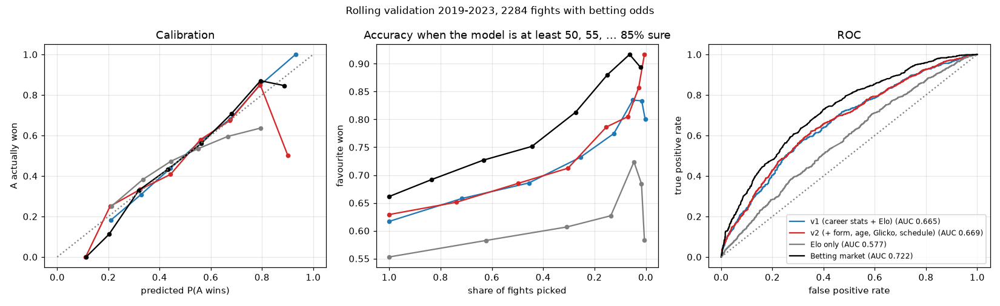

# UFC Embedded: technical details

The long version of the [README](../README.md): every feature, how each model is built and
evaluated, how Pick'em runs, and where the data comes from.

**Contents**

1. [Features](#features)
2. [Style map and fighter math](#style-map-and-fighter-math)
3. [MMA math](#mma-math)
4. [Fight predictor](#fight-predictor)
5. [Pick'em](#pickem)
6. [Architecture](#architecture)
7. [Data](#data)
8. [Performance](#performance)
9. [Stack](#stack)
10. [Limitations](#limitations)

## Features

- **[Fighter Lab](https://ufc.anarli.com/fighter-lab)**: the landing page. **Fighter math** adds
  and takes away fighting styles the way word embeddings do with meanings ("Topuria − Volume
  boxers + Dominant wrestlers = ?"), answered with the closest real fighter and drawn as arrows
  on the map. Around it, ~700 active fighters placed in 3D by how they fight. Click anyone and the camera flies to them, with lines and photo labels out to
  their 5 most similar fighters (across the map or in their own division), ranked with a
  similarity score out of 100 and what they share ("Leg kicks · Top control"). Readable style
  axes or a t-SNE similarity view; filter by style, weight class, champions or ranked fighters.
- **[Fight Predictor](https://ufc.anarli.com/predictor)**: pick two fighters for the win chance
  and the most likely outcome (who, and by KO / submission / decision), what drives the call,
  past meetings and common opponents, and a tale of the tape. Upcoming UFC cards scroll past in
  a ticker (from bookmakers' listings); click a fight to load it, with our pick next to the
  bookies'.
- **[Pick'em](https://ufc.anarli.com)**: sign in with Google or email and password, pick the
  winner of every fight on the next UFC card (and, for a bonus, how they win) before it locks
  on fight day. Live scoring during the card, private leagues with invite links, friends,
  player pages with badges and stats, the model as a player, and results emails. See
  [Pick'em](#pickem).
- **[Elo Ladder](https://ufc.anarli.com/ladder)**: every fighter rated chess-style from every
  UFC fight since 1994, next to their official rank, with the year's biggest climbers and drops.
- **[MMA Math](https://ufc.anarli.com/mma-math)**: a calculator that "proves" any fighter beats
  any other with a chain of wins, drawn as a circle that animates from winner to loser. One
  click turns the proof into a square image for Reddit, Instagram or WhatsApp, and the link
  reopens the same proof. Plus loops of fighters who beat each other in a circle.
- **Fighter cards everywhere**: collectible-style cards (style = card type, Elo where the HP
  would be, signature stats as moves, gold holo for champions) that flip in 3D to a fighter
  file. They show up in the predictor, the style map, MMA math hovers and the ladder.
- **[About](https://ufc.anarli.com/about)**: a one-screen overview of the data, the Python
  pipeline and the pages.
- **Installable**: a web app manifest, so phones can add it to the home screen.

## Style map and fighter math

1. Take fighters active in the last 3 years with at least 3 UFC fights (~700).
2. Rebuild 14 style stats from every fight's totals: output, accuracy, knockdowns, strikes
   absorbed and defence; where strikes land (body, legs) and where they're thrown from (clinch,
   ground); takedowns, takedown accuracy/defence, control time and submission attempts.
3. **Shrink** noisy stats toward the average using real counts (minutes, attempts), so a 100%
   takedown accuracy from 1 attempt doesn't count, then log-transform the skewed rates and
   standardise.
4. **Learn the metric** (`learn_metric`): how the 14 standardised stats combine into the
   embedding is learned from the fights, with linear discriminant analysis and every fighter as
   a class. Each fighter's fights are split into two halves five ways (alternate fights, and
   four random splits); the differences between halves are the noise, the spread of whole
   careers the signal, and the embedding `x @ W` maximises signal over noise. Stats that
   wobble from fight to fight count less, and stats that say the same thing (output and
   knockdowns, takedowns and control) stop being counted twice. It learns from every fighter's
   fights since 1994, not only the active ones. Takedowns and control time count the most;
   takedown defence and clinch work the least.
5. **Test** the embedding: split each fighter's fights alternately into two halves and look for
   one half's profile among everyone's other halves (the 517 active fighters with 6+ fights).
   The learned embedding is scored fairly: the fighters are split into 5 groups, and each
   group is scored with a metric learned without their fights. A second test predicts forward:
   a profile from all but a fighter's last 3 fights looks for those 3 (393 fighters with 8+).

   | Embedding | Own other half: top 10 | Top 1 | Median rank | Last 3 fights: top 10 | Median rank |
   |---|---|---|---|---|---|
   | 8 UFCStats career averages | 17.8% | 3.9% | 70 | | |
   | 14 stats | 28.2% | 10.1% | 38 | | |
   | 14 stats, stability-weighted (before) | 32.9% | 10.8% | 27 | 23.7% | 41 |
   | **14 stats, learned metric (deployed)** | **36.8%** | **15.1%** | **22** | **25.7%** | **34** |

   `uv run python -m ufc_embedded.style_map` reproduces this. Tried and left out:
   - **Opponent-adjusted stats** (each stat against what that fight's opponent usually
     allows): worse on both tests, likely because good fighters mostly face good opponents,
     so adjusting strips out real signal along with the opponent's.
   - **Weighting recent fights more** (half-life 6 years): slightly better at finding the
     last 3 fights (27.0%) but worse at finding the other half (35.4%), with fewer top-1 hits
     on both, so not worth it.
6. Two layouts:
   - **Style axes:** hand-defined Grappling, Striking and Defence scores (weighted stat
     averages), readable by construction. PCA/varimax axes were tried first, but the data's
     strongest pattern is "accuracy", which made them hard to name.
   - **Similarity:** t-SNE, which keeps far more true neighbours together but has meaningless
     axes.

   Each layout reports how many of every fighter's 10 nearest neighbours (in the full
   embedding) it keeps: about 15% for style axes vs 47% for t-SNE in 3D.
7. k-means for five styles (kickboxers, volume boxers, dominant wrestlers, clinch fighters,
   low-volume all-rounders), nearest neighbours in the embedding for "most similar". The match
   score runs 0-100: 100 is the same style, 0 is as far apart as a typical pair of fighters.
8. **Fighter math** (`web/src/features/style-map/mathModel.ts`): a fighter is their
   standardised stats, a style the average of its fighters, and a sum such as "Topuria −
   Volume boxers + Dominant wrestlers" is added up in those 14 numbers. The answer is the real
   fighter closest to the sum in the learned embedding (the terms themselves don't count), the
   same distance the "most similar" lists use, so the two always agree. Everything involved is
   linear, so the sum means something: the embedding is `x @ W`, and the Style axes layout is a
   fixed linear map of the stats too (`axes_projection`), which is why the arrows drawn on it
   add up exactly. They show 3 of the 14 dimensions, so the answer can sit a little off the
   last arrow's tip. Each fighter or style can be in a sum once: adding the same style twice
   only pushes the sum off the map.
9. Current champions and rankings come from the official rankings; fighter photos (free
   licences only, about a third of fighters) from Wikipedia.

## MMA math

1. Every decisive UFC fight since 1994 is an edge from winner to loser (draws and no contests
   are skipped). Fighters are identified by their UFCStats id, so namesakes stay apart.
2. Simple cycles of 3 to 5 fighters are found with networkx and ranked by the "fame" of the
   least known fighter in the loop (UFC fights, title wins, current belt).
3. The calculator runs a breadth-first search in the browser for the shortest chain of wins
   from one fighter to another, drawn as a circle (⇅ swaps the direction). Over 1,200 fighters
   form one strongly connected component, so within it anyone "beats" anyone.
4. "Share this proof" draws the same circle on a canvas (photos, arrows, results, the verdict)
   as a 1080 x 1080 PNG, sized to the chain's length, and hands it to the phone's share sheet
   or offers download / copy.

## Fight predictor

**Data without leakage.** UFCStats career stats and W-L-D records are *as of today*, so using
them to predict past fights would leak the results. Every feature is rebuilt from per-fight
stats using only fights on *earlier dates* (`features.py`), and a test checks that changing a
future fight changes no earlier feature. The raw data also always lists the winner first, so
fighters are randomly assigned to corners A and B.

**Features.** Two versions, both built only from fights before the one being predicted.

- **v1:** 28 career features per fighter plus Elo. Experience (UFC fights, cage minutes), form
  (win rate, win / loss streaks), finishing (KO and submission win rates, how often they get
  finished), pro record going in, age, layoff, height, reach, stance, and shrunk per-minute
  rates for striking, defence, takedowns, submissions, control time and knockdowns.
- **v2 (deployed):** v1 plus recent form (margins over opponents in results, strikes,
  takedowns, control and knockdowns: a weighted average favouring recent fights and the last
  3 fights), an age curve (years past 32, distance from 30), a **Glicko** rating instead of
  Elo (a rating plus how sure we are about it: newcomers start unsure, and it grows again
  during layoffs), strength of schedule (average rating of past opponents) and distance below
  their career peak.

**Models** (`train.py`, all deliberately simple: ~9k fights is too little for deep nets):

| Model | What it is |
|---|---|
| Betting market | Consensus bookmaker odds with the margin (vig) removed: the benchmark |
| Elo | Online rating, K tuned on validation |
| **Win model** | L2 logistic regression on A − B feature differences, no intercept, so P(A beats B) = 1 − P(B beats A) exactly |
| **Method model** | Multinomial logistic regression for KO/TKO vs submission vs decision *given the winner*, from the winner's finishing profile, the loser's durability and the weight class |

Gradient boosting (sklearn's HistGradientBoosting, trained on both corner orders and
symmetrised) was tried on the same features and did *worse* than the logistic regression
(rolling log loss ~0.659): there's too little signal per fight for it to find interactions the
linear model misses.

**Evaluation.** Split by time: train ≤ 2021, tune on 2022–23, and the 2024+ test set stays
locked until a final run (`--final`). Feature sets are compared on **rolling validation**: each
year 2019–23 is predicted by a model trained on all earlier years (2,457 fights).

| Rolling 2019–23 | Accuracy | Log loss ↓ | AUC |
|---|---|---|---|
| **Win model v2** | **62.2%** | **0.652** | **0.661** |
| Win model v1 | 61.1% | 0.654 | 0.657 |
| Elo | 55.5% | 0.685 | 0.578 |
| Betting market (2,284 fights with odds) | 66.2% | 0.614 | 0.722 |

Accuracy counts how often the fighter given over 50% won; log loss also rewards being
confident only when it's deserved, so it's the main metric. Calibration, ROC and
accuracy-vs-coverage (how often the favourite wins when the model is at least 60, 70, 80%
sure) on fights with odds:

On the 2022–23 validation years (896 fights) the deployed v2 scores 65.5% / 0.638, against
63.2% / 0.645 for v1 and 69.0% / 0.596 for the market. The gap to the market is information
the stats don't have: injuries, short notice, camps, and debutants' pre-UFC careers.

Method model: log loss 0.990 vs 1.041 for always predicting the base rates. Everything (sweep
curves, calibration plots, feature weights, worst misses, disagreements with the market, an
Elo leaderboard and the dataset) is logged to Weights & Biases.

**Reality check.** Scored with pre-fight data only, the v1 model got 5 of 14 winners right at
UFC 333 (2026-10-24), including both headliners wrong. One card is a small sample, but it
shows what career averages miss (rematches, decline with age, short UFC records).

**In the browser.** `train.py --features v1|v2` (default v2) exports the deployed weights (fit
on fights before 2024) and every active fighter's features as of today to `predictor.json`;
the page evaluates both models client-side, no server needed. Opponents are limited to the
same gender and at most one division apart: the UFC has never had bigger gaps, so the model
has learned nothing about size beyond that.

## Pick'em

**Playing.** Every fight on the next cards, from Wikipedia: main card, prelims and title
fights. Picks lock at noon local time on fight day (7 am for East Asia and Oceania). The main
card scores **10** for the winner, **+5** for the method (KO/TKO, submission, decision),
**+5** for calling an underdog by the bookmakers' odds. Prelims score **1** for the winner,
with no bonuses (since November 2026, applied to past cards too).

**The model plays too.** An account called `the_model` picks every bout with the deployed win
and method models, like a player: only while the bout is open, never changed after the lock,
and public once the card locks. When it can't predict a bout (a UFC newcomer), it takes the
bookmakers' favourite, or the UFC veteran over the debutant, by decision.

**Social.** Private leagues (up to 5 of your own, 1000 members each) with invite links;
friends; after the lock, your league-mates' faces under the fighter each picked and the
crowd's split on every bout. Player pages with a record, badges, best call, method calls, a
points chart and head-to-head against the model and friends.

**Results, live.** `pickem_sync.py` reads each card from Wikipedia (`fight_cards.py`) and
writes cards, changes and results to the database as one SQL transaction, safe to repeat:

- after every main-card result, `tally_event` recounts everyone's points, so the standings
  move fight by fight;
- once every bout has a result, `score_event` marks the card scored: the final podium shows
  and a database webhook sends the results emails (Supabase Edge Function + Resend);
- every sync and every result leaves a line in `pickem_log`.

It runs in GitHub Actions (`.github/workflows/pickem-sync.yml`), triggered every 5 minutes
by an external scheduler (cron-job.org, through GitHub's workflow-dispatch API with a token
that can only start this workflow), since GitHub's own schedule runs late or not at all on
busy evenings. The built-in schedule stays as a backup, and `scripts/pickem-sync.sh
[--every 5]` runs the same sync from a laptop.

**Security.** Supabase (Postgres + Auth, Frankfurt) is reached straight from the browser with
its public key; what each visitor may read and write is enforced by row level security in
the database, and the rules are tested on every push (`supabase/tests`, including attack
cases). See [supabase/README.md](../supabase/README.md).

## Architecture

- **Data contract:** `export.py` writes JSON with a `schema_version`; `web/src/data/types.ts`
  mirrors it. Moving to a real API later only changes `client.ts`. The style map sends only
  what the browser can't work out itself; `web/src/data/styleMap.ts` rebuilds the rest on load
  (see [Performance](#performance)).
- **Features are modular:** each product lives in `web/src/features/<name>/` and is
  lazy-loaded by its route.
- **Accounts:** `web/src/backend/` is the only code that knows it's Supabase, behind a
  `Backend` interface, with an in-browser demo backend for development
  (`VITE_ACCOUNTS=demo`).
- **CI/CD:** every push to `master` runs ruff, mypy, pytest, the database tests, the web tests
  and the build, then deploys to GitHub Pages. The `beta` branch is built separately on
  Cloudflare at beta.anarli.com, for trying things before they reach the live site. Both
  download the site's data from a GitHub Release first (below). A weekly workflow backs up the
  database, encrypted.

## Data

**Automatic refresh.** `.github/workflows/data-refresh.yml` runs on Mondays (the weekend's card
is in the datasets by then) and Thursdays (fresh odds for the next card), or by hand from the
Actions tab. It downloads the datasets, rebuilds the style map, MMA math, ratings and
predictions, refuses the result if `check_data.py` or the tests object, and otherwise publishes
the new JSON and deploys. Each run, or failure, leaves a line in `pickem_log` (visible in the
admin panel). The model's weights don't change (they're fit on fights before
2024); every fighter's stats move to the latest card.

**Where the site's data lives.** The three JSON files aren't in git. A refresh uploads them to a
GitHub Release, `data` for the live site, and every build downloads them into
`web/public/data` (`web/scripts/fetch-data.mjs`; `npm run build` does it when they're missing,
`npm run data` replaces them). Visitors still get them from the site's own domain, so
nothing changes for them. Before, every refresh committed about 3 MB of JSON: the repository
grew with each one, and the beta branch's own data clashed with master's on every merge.

- **Beta's data:** run the refresh by hand with *target: beta*. It builds from the `beta`
  branch, uploads to a `data-beta` release and pushes an empty commit so Cloudflare rebuilds
  beta. Without a `data-beta` release, beta uses the live site's data.
- **Going back:** each run's JSON is also kept as a workflow artifact for 90 days; uploading an
  older one to the release (`gh release upload data *.json --clobber`) and rerunning CI rolls
  the site back.
- **Working locally:** `node web/scripts/fetch-data.mjs` gets the live data, or the export and
  training commands build your own.

Raw data isn't committed. `scripts/download-data.sh` fetches these regularly updated Kaggle
datasets into `data/raw/<dataset-name>/` (no account needed for public datasets):

| Dataset | Used for |
|---|---|
| [`scarekrow/ufc-data`](https://www.kaggle.com/datasets/scarekrow/ufc-data) | Every UFC fight (UFCStats), fighter records and career stats |
| [`valihameed/ufc-stats`](https://www.kaggle.com/datasets/valihameed/ufc-stats) | Betting odds up to 2024 (MMA math upsets, market baseline fallback) |
| [`jerzyszocik/ufc-betting-odds-daily-dataset`](https://www.kaggle.com/datasets/jerzyszocik/ufc-betting-odds-daily-dataset) | Betting odds keyed by UFCStats ids, incl. 2025+ (market baseline) |
| [`jerzyszocik/ufc-rankings-history`](https://www.kaggle.com/datasets/jerzyszocik/ufc-rankings-history) | Official rankings and current champions |

Fighter photos are cached in `data/processed/fighter_photos*.json` (committed, so a refresh
only looks up new fighters); delete them to refresh them all.
Pick'em cards and results come from Wikipedia at sync time.

## Performance

Fighter Lab is the landing page, so its first load is what most visitors wait for. In November
2026 it went through one round of work, measured with a script that loads the page in a fresh
browser, as a phone (412 px wide, CPU slowed down 4×) on throttled mobile connections, and times
how long it takes until the fighter math answer is on screen (median of 5 cold loads; local
server with gzip, so real latency comes on top):

| | Fast 4G | Slow 4G | The site's bytes before the answer |
|---|---|---|---|
| Before | 3.65 s | 10.7 s | 1001 KB |
| Lean style map + right prefetch | 2.94 s | 8.5 s | 675 KB |
| + Fighter Lab's code preloaded | **2.44 s** | **8.0 s** | 675 KB |

Three changes:

1. **The style map sends only what the browser can't work out (schema 7).** Most of
   `style_map.json` was things derived from each fighter's 14 standardised stats ("vec"):
   the 5 most similar fighters twice (overall and in the division), the percentiles of every
   stat, and the position on Style axes. All three are cheap to work out from `vec`, the
   learned metric and the axes projection, which the file already had for fighter math, so
   `web/src/data/styleMap.ts` does it on load in a few milliseconds:
   - Style axes positions are a linear function of `vec`, so they're exact
     (`test_style_map.py` checks the projection against the pipeline's own positions).
   - Percentiles rank every stat across the map, ties sharing their average rank, as pandas
     did.
   - The most similar fighters are the nearest in `vec @ metric`, worked out for the fighter
     being looked at.

   Stats now come as arrays in a fixed order instead of objects repeating 14 long key names
   per fighter. Checked against the last full export: 720 of 723 fighters get exactly the same
   most-similar list (the other 3 swap a near-tie, from rounding), no similarity score moves by
   more than 1 and no percentile by more than 1 point. The file went from **1.48 MB to 396 KB**
   (271 KB to 102 KB gzipped).
2. **The landing page fetches the right data.** When "/" became Fighter Lab, the code that
   starts the first page's download early still fetched the predictor's data for it: 183 KB
   (gzipped) that the page didn't use, competing with the style map. It now starts the style
   map, and the predictor's data only for Pick'em links.
3. **Fighter Lab's code starts downloading with the page.** It's loaded lazily (three.js is
   most of it, 236 KB gzipped), so it used to start only after the main script had arrived and
   run. A few lines at the top of `<head>`, written by a Vite plugin (`preloadLanding` in
   `vite.config.ts`), start those downloads straight away on the landing page, in parallel
   with the main script. Other pages don't load them.

**Next, if it's needed:** three.js is now the biggest single download. Showing a light 2D
version of the map first and the 3D scene once it has loaded would make the first answer
appear sooner on slow connections. The Supabase client (29 KB) also loads on every page, for
the account menu, and could wait until someone signs in.

## Search pages

`web/scripts/route-previews.mjs` writes a real HTML page at build time for every fighter
(`/fighters/<id>/`), upcoming card (`/cards/<name>/`) and upcoming fight (`/fights/<a>-vs-<b>/`),
with its own title, description, structured data and sitemap entry. The content comes from
`web/src/features/seo/` and the site's JSON, so each data refresh updates the pages. A test checks
that every page has a unique title and that no internal link is dead.

## Stack

Python 3.12 with uv, pandas, scikit-learn, networkx; ruff, mypy (strict), pytest; Weights &
Biases for experiments. Web: Vite, React, TypeScript, Mantine, react-three-fiber/drei,
TanStack Query; vitest. Accounts: Supabase (Postgres with row level security, Auth with Google
and email), Edge Functions (Deno), Resend for email. Hosting: GitHub Pages, Cloudflare (DNS,
beta site).

## Limitations

- Career averages hide style changes over time; fighters with few fights are noisy.
- Rankings and champions are matched to fighters by name, so namesakes could be confused.
- Live results are only as fast as Wikipedia's editors (usually minutes after each fight).
